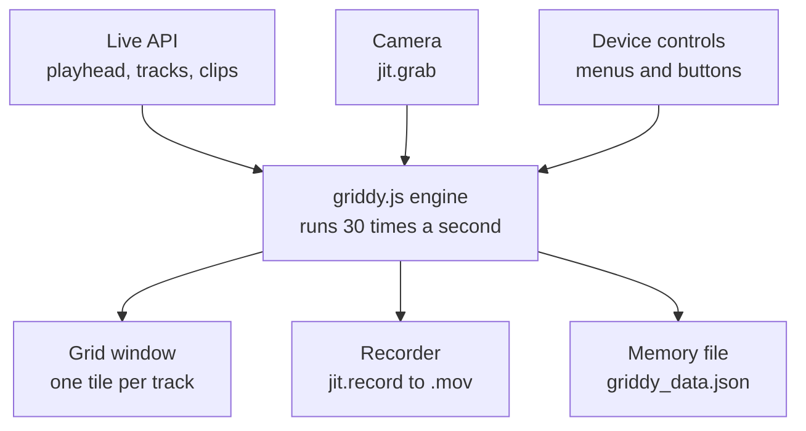
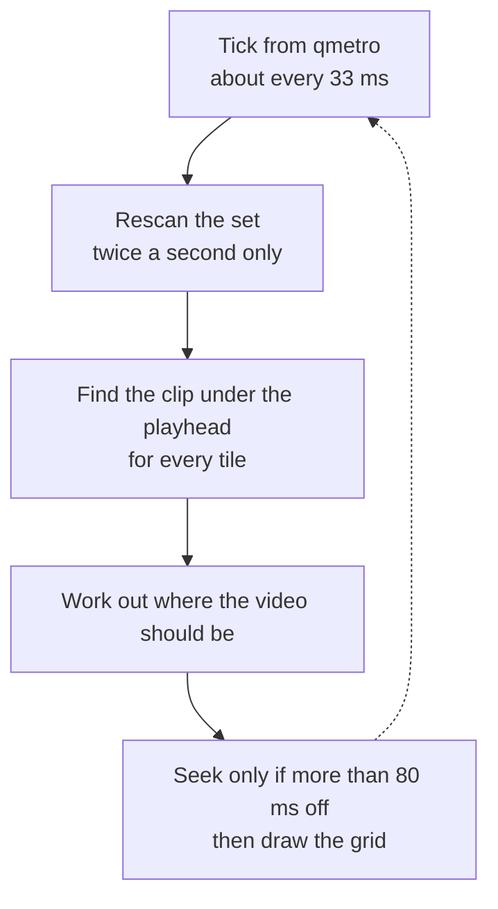
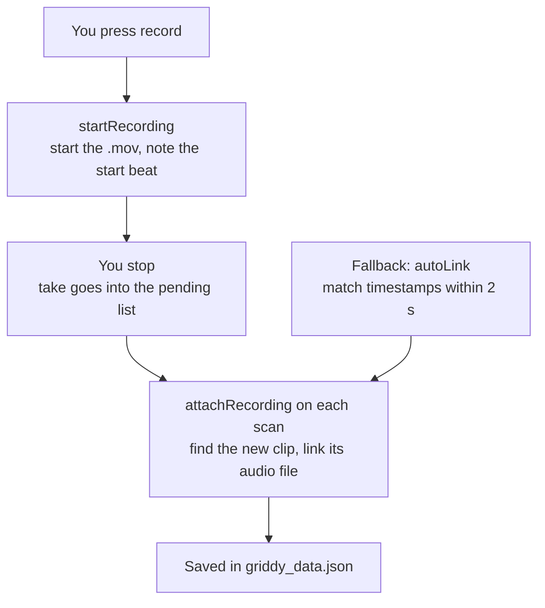

# How Griddy works

Live is the conductor; Griddy is a video player that keeps checking where the conductor is. It never keeps its own time. About 30 times a second it asks Live where the playhead is and moves every video to match.

## The pieces



`Griddy.amxd` is the wiring. `griddy.js` makes every decision. The patch sends messages such as `frame`, `camera` and `importvideo`, and each one runs the function of the same name in the script.

## Every frame



The sync line in `drawTile()`:

```js
var audioMs = (beat - clip.start + clip.marker) * 60000 / v.tempo;
var target  = audioMs + v.leadMs + currentOffset();
```

Example: the clip starts at beat 8, the playhead is at beat 12, tempo 120. That is 4 beats into the clip, and 4 beats at 120 BPM is 2000 ms, so the video should be at 2 seconds. Everything is in beats, the unit Live uses, so stop, loop and scrubbing need no special code.

Seeking is expensive and causes stutter, so videos play freely and only jump when they drift past 80 ms (loop wraps, clicking somewhere new, slow drift).

## Recording and linking a take



Each video is linked to the clip's audio file, not to a track:

```json
"/.../Samples/Recorded/REC 0006 [2026-10-22 193042].wav": {
  "video": "T7:/.../REC 20261022 193042.mov",
  "tempo": 120,
  "leadMs": 0
}
```

An audio file is unique to its recording and stays the same when the clip is moved, trimmed or duplicated, so the video follows the clip anywhere. The grid shows every track whose main lane has linked clips, plus armed tracks for a live camera preview.

## Things to know when editing

* Every Live API call is slow, so the full set scan runs twice a second, not every frame.
* Live does not allow changing the set from inside an observer callback. Do edits from the frame tick.
* Max objects created in the script must be freed (`freepeer()`) or they linger, like an extra grid window.
* A Max `Task` held only in a local variable can be thrown away before it fires. Keep tasks in globals.
* Only one Griddy runs per set. A second copy stays off and says so on its status line.
